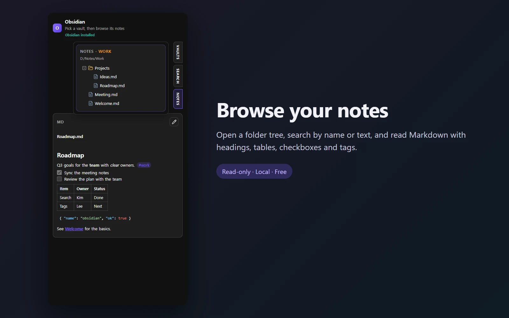
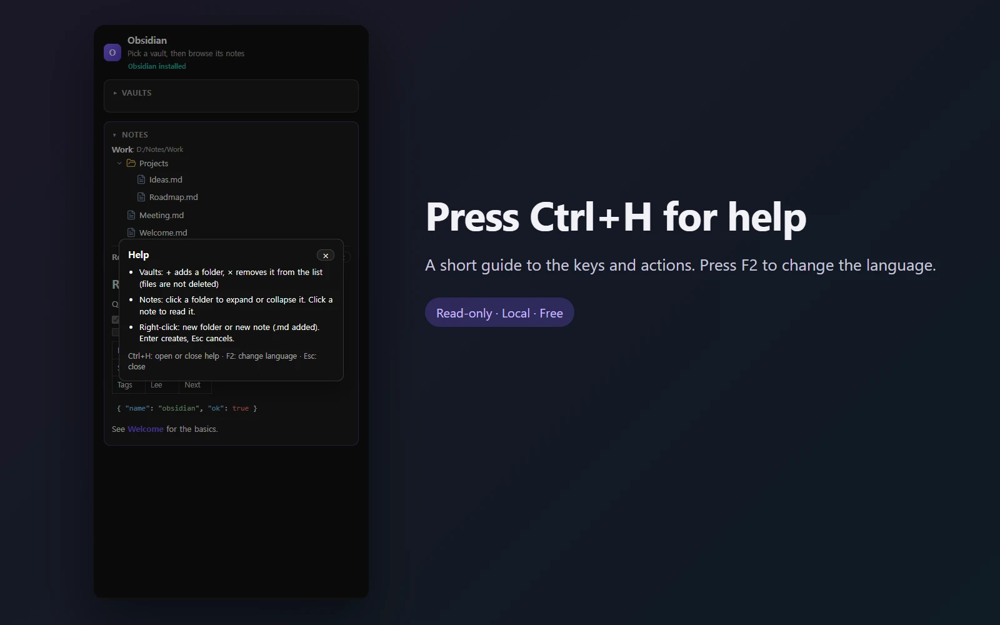

# Obsidian for Orca

[English](README.md) | [**한국어**](README.ko.md)

Orca 사이드바에서 [Obsidian](https://obsidian.md) 볼트를 둘러보고 노트를 읽는 플러그인입니다. 노트는 일반 Markdown 파일이라 어떤 폴더든 볼트로 쓸 수 있습니다.

## 스크린샷

## 기능

- **탭**: 사이드바에 VAULTS, SEARCH, NOTES 탭이 있고, 노트 그래프 위로 밀려 나옵니다. 열린 탭이나 노트 영역을 누르면 접힙니다.
- **볼트**: `+` 로 폴더를 볼트로 추가하고(폴더 선택창이 열립니다), `×` 로 목록에서 뺍니다. 빼도 파일은 지워지지 않습니다.
- **노트**: 폴더를 누르면 펼치거나 접고, 노트를 누르면 내용을 봅니다.
- **읽기**: 제목, 목록, 체크박스, 표, 코드 블록(색칠 포함), `**굵게**`, `*기울임*`, `` `코드` ``, `[[위키링크]]`, `#태그`를 보여 줍니다. 맨 위 YAML 머리말은 숨깁니다.
- **그 자리에서 만들기**: 폴더에서 우클릭하면 *새 폴더*, *새 노트 (.md)* 를 고를 수 있습니다. 이름은 쓰기 전에 확인하고, 같은 이름이 있으면 덮어쓰지 않습니다.
- **언어**: 영어, 한국어, 일본어, 독일어, 스페인어, 프랑스어, 러시아어를 지원합니다. 기본은 Orca의 브라우저 언어이고, **F2** 로 바꿉니다.
- **그래프**: `[[링크]]` 로 만든 노트 그래프입니다. 노드를 누르면 노트를 엽니다.
- **검색**: SEARCH 탭에서 노트를 검색합니다. `#태그` 를 누르면 그 태그로 검색합니다.
- **링크**: `[[위키링크]]` 를 누르면 연결된 노트를 엽니다.
- **Obsidian에서 편집**: Obsidian에 등록된 볼트는 노트를 Obsidian에서 바로 엽니다.
- **도움말**: **Ctrl+H** 로 단축키 목록을 봅니다.
- **릴리스 노트**: [docs/release-notes.md](docs/release-notes.md) 를 보세요.

## 요구 사항

- Orca 1.4.246 이상
- Windows에서 테스트했습니다.
- Obsidian 설치는 선택 사항입니다. 설치 여부만 표시하며, 노트를 읽는 데는 Obsidian이 필요하지 않습니다.

## 권한

이 플러그인은 사용자 계정 권한으로 별도 Node.js 프로세스(`trusted-worker`)에서 실행됩니다. 처음 불러올 때 Orca가 승인을 묻습니다.

워커가 하는 일:

- 추가한 볼트 폴더와 그 안의 `.md` 노트를 **읽습니다** (노트당 최대 1MB).
- 사용자가 *새 폴더*, *새 노트* 를 고르고 이름을 확인했을 때만 폴더나 빈 `.md` 노트를 **만듭니다**.
- 기본 설치 위치의 `Obsidian.exe` 가 있는지 **확인합니다**.
- 볼트 목록과 언어 설정을 플러그인 전용 저장소(`storage:own`)에 **저장합니다**.

네트워크로 데이터를 보내지 않으며, 위 두 가지 동작 외에는 볼트에 쓰지 않습니다.

## 알려진 제한

- 이미지, `[글자](주소)` 링크, 번호 목록 다시 매기기는 아직 지원하지 않습니다.
- 표의 칸 정렬(`:---:`)은 무시하고 항상 왼쪽 정렬입니다.
- 코드 색칠은 키워드 목록 기반의 대략적인 색칠입니다. 언어의 전체 문법을 분석하지 않습니다.
- 패널에서 노트는 읽기 전용입니다. 편집은 Obsidian("Obsidian에서 편집")이나 다른 편집기에서 합니다.

## 개발

[docs/development.md](docs/development.md) 를 보세요.

## 라이선스

MIT. [LICENSE](LICENSE) 를 보세요. 아이콘은 Lucide 아이콘 세트(ISC)의 경로를 사용합니다.

## 프로젝트 후원

이 프로젝트가 도움이 되었다면 개발자에게 커피 한 잔 후원을 고려해 주세요.

