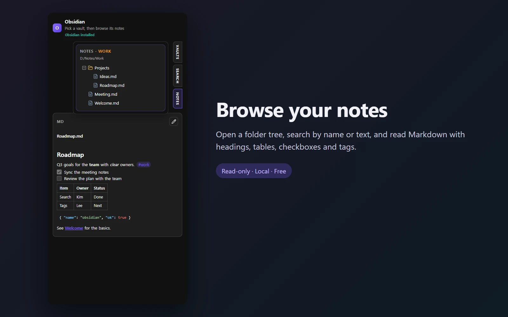
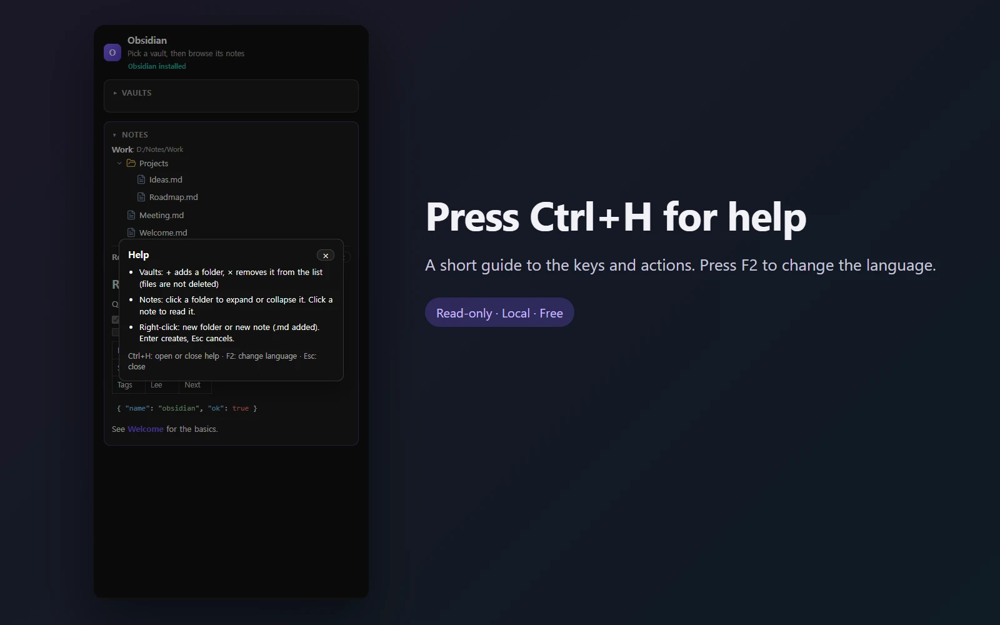

# Obsidian for Orca

[**English**](README.md) | [한국어](README.ko.md)

Browse and read your [Obsidian](https://obsidian.md) vaults from the Orca sidebar. Notes are plain Markdown files, so any folder works.

## Screenshots

## Features

- **Vaults**: add a vault folder with `+`, remove it from the list with `×`. Removing never deletes files.
- **Notes**: expand and collapse folders, click a note to read it.
- **Reading**: headings, lists, checkboxes, tables, code blocks with highlighting, `**bold**`, `*italic*`, `` `code` ``, `[[wikilinks]]` and `#tags`. The YAML front matter at the top is hidden.
- **Create in place**: right-click a folder for *New folder* or *New note (.md)*. Names are checked before anything is written. Existing items are never overwritten.
- **Languages**: English, Korean, Japanese, German, Spanish, French and Russian. The language follows Orca's browser language; press **F2** to change it.
- **Help**: press **Ctrl+H** for the shortcut list.

## Requirements

- Orca 1.4.246 or later
- Tested on Windows.
- Obsidian is optional. The plugin shows whether Obsidian is installed, but it does not need Obsidian to read notes.

## Permissions

This plugin runs its code in a separate Node.js process (`trusted-worker`) with your user account's access. Orca asks you to approve this when you first load it.

What the worker does:

- **Reads** the vault folders you add, and the `.md` notes inside them (up to 1 MB per note).
- **Creates** a folder or an empty `.md` note only when you choose *New folder* or *New note* and confirm the name.
- **Checks** whether Obsidian is installed, by looking for `Obsidian.exe` in its default install folder.
- **Stores** the vault list and the language in the plugin's own storage (`storage:own`).

It does not send data over the network, and it does not write to the vault except the two actions above.

## Known limits

- Images, links `[text](url)` and numbered-list renumbering are not rendered yet.
- Syntax highlighting is approximate: it uses keyword lists, not full language grammars.
- Notes are read-only in the panel. Editing is done in Obsidian or your own editor.

## Development

See [docs/development.md](docs/development.md).

## License

MIT. See [LICENSE](LICENSE). The icon uses the Lucide icon set (ISC).

## Support the project

If this project is useful to you, consider buying the developer a coffee.

